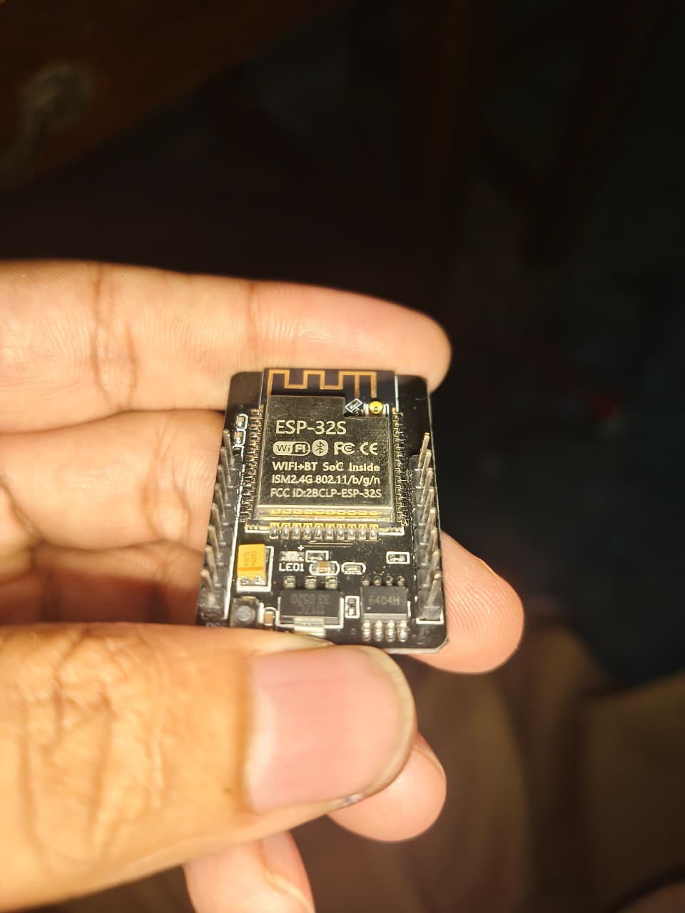
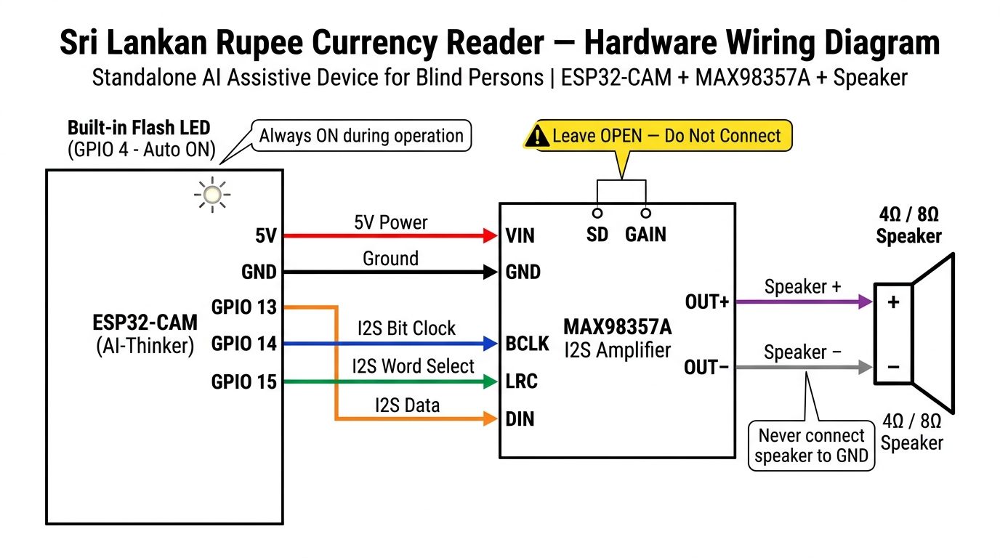

# 💵 AI-Based Sri Lankan Currency Identification System for Visually Impaired People

[](https://www.espressif.com/)
[](https://www.edgeimpulse.com/)
[]()
[](LICENSE)
[](https://github.com/rihaf43)

A low-cost, fully standalone, handheld **Edge AI assistive device** that identifies Sri Lankan currency notes (Banknotes of the 11th Series) in real time and speaks the denomination aloud in natural voice.

Developed using an **AI-Thinker ESP32-CAM**, an **Edge Impulse FOMO** object detection neural network, and a **WeAct Studio PCM5100A I2S DAC** module driving an audio speaker. The system runs **100% offline** on edge silicon without requiring a smartphone, mobile application, or internet connectivity.

---

## 📹 Demonstration Video

Watch the real-time banknote recognition and instant voice announcement in action:

[](https://youtube.com/shorts/eZGc0GhKy8c)

> 🔗 **[Click here to watch the full demonstration on YouTube Shorts](https://youtube.com/shorts/eZGc0GhKy8c)**

---

## 📸 Hardware Prototype & Circuit Diagram

| Physical Prototype | System Wiring Diagram |
| :---: | :---: |
|  |  |

---

## 🌟 Key Features

* **⚡ Real-Time Embedded Inference (<40 ms):** Runs a quantized `int8` FOMO (Faster Objects, More Objects) MobileNetV2 neural network directly on the ESP32 dual-core microcontroller with 4MB PSRAM.
* **🔊 Crystal-Clear I2S Voice Output:** High-fidelity speech announcement via digital I2S audio (`PCM5100A` 32-bit DAC + audio amplifier), bypassing noisy analog PWM audio.
* **💡 25 kHz Ultrasonic PWM Flash Illumination:** High-frequency flash PWM completely above the human hearing spectrum (>20 kHz), providing zero coil whine/whistling noise while guaranteeing uniform illumination across daylight and dark conditions.
* **📶 Completely Offline & Independent:** Requires no Wi-Fi, cloud subscriptions, or smartphone pairing. Ideal for visually impaired users in rural or low-connectivity environments.
* **🔋 Standalone Handheld Power:** Powered by a rechargeable 3.7V 18650 Lithium-Ion cell with integrated TP4056 USB charging and step-up power management.

---

## 🧠 Why This Project? (Problem Statement)

Visually impaired individuals in Sri Lanka face severe accessibility hurdles when transacting in cash:
1. **Tactile Feature Wear:** The 11th series Sri Lankan Rupee banknotes feature raised-print tactile dots (Braille marks); however, circulation wear rapidly flattens these features, rendering manual recognition unreliable.
2. **Subtle Physical Differences:** All Sri Lankan banknotes share a standard width (67 mm), with only small 5 mm increments in length across denominations (from 128 mm for Rs. 20 up to 153 mm for Rs. 5,000), making tactile length estimation error-prone.
3. **Drawbacks of Smartphone Apps:** Commercial assistive mobile apps (e.g., Seeing AI, Cash Reader) require expensive smartphones, steady high-speed internet, recurring subscription fees, and introduce noticeable cloud latency.

This project delivers a **dedicated, budget-friendly (< $15 total BOM) assistive gadget** that instantly delivers audio confirmation the moment a note is held beneath the camera.

---

## 📐 System Architecture


---

## 🔌 Hardware Pinout & Connections

### 1. ESP32-CAM to WeAct PCM5100A DAC
| ESP32-CAM Pin | PCM5100A Pin | Description |
| :--- | :--- | :--- |
| **GPIO 14** | **BCK** | I2S Bit Clock |
| **GPIO 15** | **WS / LCK** | I2S Word Select (Left/Right Clock) |
| **GPIO 13** | **DIN** | I2S Serial Audio Data |
| **5V / 3.3V** | **VCC** | Power Supply |
| **GND** | **GND** | Common Ground |
| *NC* | **MC / SD** | *Leave Unconnected* |

### 2. Illumination & Flashlight
* **GPIO 4:** Onboard High-Power Flash LED driven by hardware LEDC timer channel 7 at **25,000 Hz (25 kHz)** with 50% duty cycle for ultrasonic, silent operation.

### 3. Power Circuitry
* **18650 Li-ion Cell (3.7V)** $\rightarrow$ **TP4056 Protection Module** $\rightarrow$ **DC-DC Step-Up Boost (5V)** $\rightarrow$ **ESP32-CAM 5V pin & DAC VCC**.

---

## 📊 Experimental Results

A structured evaluation was conducted across all Sri Lankan Rupee denominations under varied ambient lighting (daylight, low light, and active flash) and distances (10–20 cm):

| Denomination | Trials | Correct | Accuracy (%) | Observed Misclassifications & Notes |
| :--- | :---: | :---: | :---: | :--- |
| **Rs. 1** | 20 | 18 | **90.0%** | Minor confusion with Rs. 2 under extreme tilt |
| **Rs. 2** | 20 | 17 | **85.0%** | Misclassified as Rs. 1 under steep presentation angle |
| **Rs. 5** | 20 | 17 | **85.0%** | Confused with Rs. 10 under dim ambient lighting |
| **Rs. 10** | 20 | 18 | **90.0%** | Distinct high-contrast color scheme |
| **Rs. 20** | 20 | 16 | **80.0%** | Confused with Rs. 50 due to overlapping reddish pigments |
| **Rs. 50** | 20 | 16 | **80.0%** | Confused with Rs. 20 under specular reflection |
| **Rs. 100** | 20 | 18 | **90.0%** | High contrast orange-brown features |
| **Rs. 500** | 20 | 17 | **85.0%** | Occasional confusion with Rs. 100 and Rs. 1,000 |
| **Rs. 1,000** | 20 | 18 | **90.0%** | Distinct cyan/green features |
| **Rs. 5,000** | 20 | 15 | **75.0%** | Confused with Rs. 1,000 at steep tilt angles |
| **Total / Overall** | **200** | **170** | **85.0%** | **Average latency: < 100 ms (instant trigger)** |

---

## 📁 Repository Structure

```text
├── assets/
│   ├── demo_video_thumbnail.jpg       # Demonstration video preview thumbnail
│   ├── hardware_wiring_diagram.jpg    # Full hardware schematic & connection diagram
│   └── prototype_device.jpg           # Photograph of the working physical prototype
├── docs/
│   ├── Currency_Identification_Project_Report.docx  # Full comprehensive academic project report
│   └── Currency_Identifier.pptx                      # Presentation slide deck
├── firmware/
│   └── CurrencyReaderArduino/
│       ├── camera_pins.h               # AI-Thinker OV2640 pin definitions
│       ├── currency_audio.h            # 16kHz raw PCM voice prompt buffers
│       └── CurrencyReaderArduino.ino   # Core Arduino application with DMA downsampling & I2S playback
├── .gitignore
├── LICENSE
└── README.md
```

---

## 🛠️ Software Setup & Flashing

### Requirements
1. **Arduino IDE 2.x** (or PlatformIO).
2. **ESP32 Board Package:** Install version `2.0.14` or later via Arduino Boards Manager (`https://raw.githubusercontent.com/espressif/arduino-esp32/gh-pages/package_esp32_index.json`).
3. **Edge Impulse Inferencing Library:** Export the deployed C++ Arduino library from your Edge Impulse model (`rihab40-project-1_inferencing.zip`) and add it via **Sketch $\rightarrow$ Include Library $\rightarrow$ Add .ZIP Library...**.

### Arduino IDE Board Settings
* **Board:** `AI Thinker ESP32-CAM`
* **CPU Frequency:** `240MHz (WiFi/BT)`
* **Flash Frequency:** `80MHz`
* **Flash Mode:** `QIO`
* **Partition Scheme:** `Huge APP (3MB No OTA/1MB SPIFFS)`
* **Core Debug Level:** `None`
* **PSRAM:** `Enabled`

### Flashing Procedure
1. Connect the ESP32-CAM to your computer using a USB-to-UART FTDI programmer (Set voltage jumper to **5V**).
2. Connect `GPIO 0` to `GND` to enter flash bootloader mode.
3. Hit **Upload** in Arduino IDE.
4. Once upload completes, disconnect `GPIO 0` from `GND` and press the **RST** button to start real-time inference.

---

## 🎓 Academic Information & Authors

This project was engineered as part of the Robotics curriculum:
* **Institution:** Department of Engineering Technology, Faculty of Technology, **University of Jaffna**, Sri Lanka
* **Course:** Robotics – ETE429TC3 (Bachelor of Engineering Technology - Electro Specialization)
* **Team:** Group 21
  * **MMM. Riwaf** (Reg: `2021/ET/069`) — GitHub: [@rihaf43](https://github.com/rihaf43)
  * **S. Sathoos** (Reg: `2021/ET/104`)

---

## 📜 License

This project is licensed under the **MIT License** — see the [LICENSE](LICENSE) file for details.
